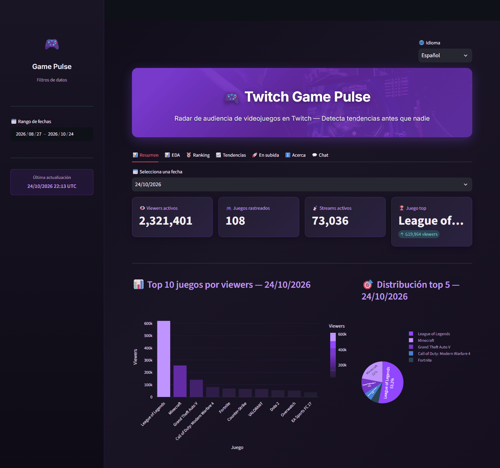
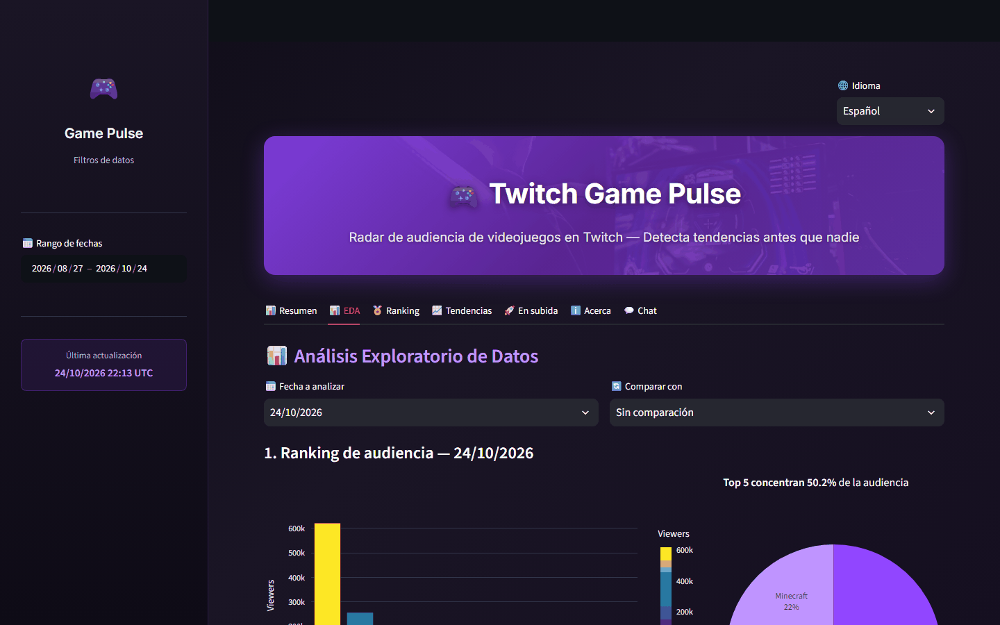

# Twitch Game Pulse

**Radar de audiencia de videojuegos en Twitch: qué juegos ganan o pierden espectadores, con datos que se actualizan solos cada día.**

[](https://twitch-game-pulse.vercel.app) [](https://github.com/alvarodc093-pixel/Twitch-Audience-Analytics/actions/workflows/ingesta_diaria.yml)   



## En resumen

- **Problema:** sin herramientas de pago es difícil saber qué juegos están creciendo en Twitch, una señal clave para marketing y patrocinios.
- **Datos:** snapshots diarios del top 100 de juegos de la API Helix de Twitch, recogidos por un workflow de GitHub Actions.
- **Resultado:** en septiembre, World of Warcraft (+245 %) y Phasmophobia (+238 %) fueron los que más crecieron, y el top 5 concentraba solo el 21,5 % de la audiencia.
- **App:** dashboard en Streamlit con ranking, tendencias, crecimiento semanal y variabilidad, en 5 idiomas.

## Problema

Sin herramientas de pago (SullyGnome, StreamElements) es difícil saber qué juegos están creciendo o cayendo en Twitch. Esa señal sirve para decidir dónde invertir en marketing, en qué juegos patrocinar streamers o cuándo lanzar contenido.

Este proyecto guarda cada día una foto del top 100 de juegos de Twitch y, con esa serie, muestra rankings, tendencias, crecimiento semanal y variabilidad de la audiencia.

## Datos

[Twitch Helix API](https://dev.twitch.tv/docs/api/reference/) con autenticación OAuth (Client Credentials):

- `GET /helix/games/top`: top 100 de juegos en ese momento.
- `GET /helix/streams?game_id=...`: streams activos de cada juego; se suman sus viewers.

Cada ejecución de `ingesta.py` guarda un snapshot por juego en `data/twitch_pulse.db` (SQLite). Twitch no ofrece histórico, así que la serie solo existe desde la primera ingesta (27/08/2026). Las categorías que no son juegos (Just Chatting, IRL, Music...) se filtran en la app. El detalle de tablas y columnas está en [diccionario_datos.md](diccionario_datos.md).

## Resultados (27/08 – 21/09/2026)

Del notebook [`notebooks/eda.ipynb`](notebooks/eda.ipynb), con 1.001 snapshots de 236 juegos:

- **Volumen:** GTA V lidera el último snapshot con 157.631 viewers, seguido de World of Warcraft (150.974) y Counter-Strike (111.276). El top 5 se lleva solo el 21,5 % de la audiencia.
- **Crecimiento:** World of Warcraft (+245 %), Phasmophobia (+238 %) y Destiny 2 (+197 %) son los que más suben respecto a la semana anterior.
- **Variabilidad:** WARDOGS y Rust son los más irregulares (coeficiente de variación del 148 % y 145 %); Counter-Strike es el más estable de los grandes.
- **Concentración por streamer:** juegos como BALL BOY Simulator reúnen más de 12.000 viewers por stream con solo 4 streams.

## Limitaciones

- **Huecos en la serie:** la ingesta no se ha ejecutado todos los días, y cada snapshot se tomó a una hora distinta. Como la audiencia de Twitch cambia mucho según la hora, los crecimientos indican dirección más que magnitud exacta.
- **Top 100:** solo se siguen los juegos que están en el top en el momento de la ingesta.
- Una versión anterior mezclaba 14 días de datos sintéticos con los reales; se han eliminado y los resultados están recalculados. `ingesta.py --sintetico` escribe ahora en una base aparte.

## La app



| Pestaña | Contenido |
|---|---|
| Resumen | KPIs del día elegido, top 10 y reparto del top 5 |
| EDA | Ranking, evolución del top 5, crecimiento, variabilidad y viewers por stream, con comparativa entre dos fechas |
| Ranking | Ranking del día frente al día anterior con datos |
| Tendencias | Evolución de los juegos que elijas |
| En subida | Top 10 por crecimiento semanal |
| Chat | Preguntas sobre los datos (ver abajo) |

La interfaz está en español, inglés, alemán, francés y portugués (`translations.py`).

### Chat

El chat no usa un LLM. Si la pregunta menciona un género conocido (shooter, moba, mmorpg...), responde con una consulta SQL de ranking o de crecimiento. Si no, busca las fichas de juego más parecidas en ChromaDB (búsqueda semántica con el modelo de embeddings por defecto de Chroma) y devuelve sus cifras. Las fichas las genera `preparar_corpus.py` a partir de los últimos 14 días de datos.

## Actualización automática

`.github/workflows/ingesta_diaria.yml` ejecuta la ingesta todos los días a las 18:00 UTC, reconstruye el corpus y hace commit de la base. Necesita dos secretos en *Settings → Secrets and variables → Actions*: `TWITCH_CLIENT_ID` y `TWITCH_CLIENT_SECRET`.

## Ejecutarlo en local

```bash
pip install -r requirements.txt
copy secrets_ejemplo.toml secrets.toml   # y rellena client_id y client_secret
python ingesta.py                        # añade un snapshot real
python preparar_corpus.py                # fichas para el chat
streamlit run app.py
```

Las credenciales se obtienen registrando una app en https://dev.twitch.tv/console/apps. Sin credenciales se puede probar con datos sintéticos:

```bash
python ingesta.py --sintetico            # crea data/twitch_pulse_demo.db
TWITCH_PULSE_DB=data/twitch_pulse_demo.db streamlit run app.py
```

## Estructura

```text
├── app.py                    # Dashboard de Streamlit
├── index.html                # Demo web (stlite)
├── ingesta.py                # API de Twitch → SQLite
├── preparar_corpus.py        # Fichas de tendencia → ChromaDB
├── translations.py           # Textos de la interfaz
├── diccionario_datos.md
├── data/
│   ├── twitch_pulse.db       # Snapshots de audiencia
│   └── chroma/               # Índice del chat
├── notebooks/eda.ipynb       # Análisis exploratorio
└── .github/workflows/        # Ingesta diaria
```

## Tecnologías

Python, SQLite, Pandas, Plotly, Streamlit, ChromaDB y GitHub Actions.

## Autor

Álvaro Domingo Cordón · [LinkedIn](https://www.linkedin.com/in/alvaro-domingo/) · [GitHub](https://github.com/alvarodc093-pixel)
